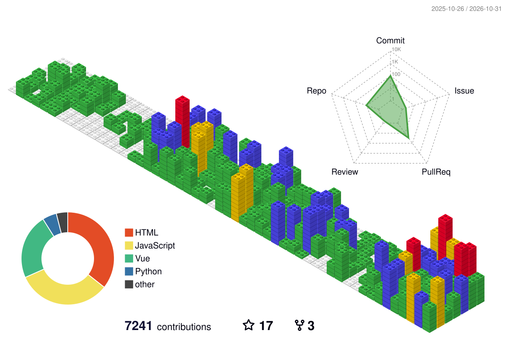

# 👋 Hello, I'm Ben Macha (BEN MECHA)! 🇵🇸 | ❤️ Open Source
I'm a **Full Stack Developer** passionate about web and mobile development, specializing in **Symfony, React, and Vue.js**. I have strong experience in software architecture and technical leadership. 🚀

## 🛠️ Tech Stack & Skills

| **Category**          | **Technologies**                                                                                                                                                    |
|-----------------------|--------------------------------------------------------------------------------------------------------------------------------------------------------------------|
| **Backend** |         |
| **Frontend** |           |
| **Database** |    |
| **DevOps & Tools** |         |
| **IDE & Development** |     |

## 📦 Packages

Symfony bundles published on [Packagist](https://packagist.org/packages/benmacha/):

| Package | What it does | Downloads |
| --- | --- | --- |
| [benmacha/diagram-bundle](https://github.com/BenMacha/diagram-bundle) | Interactive Doctrine ERD for Symfony 5.4–7.x: diagram of every entity manager, JSON API, React / Vue / Web Component studio, SVG, PNG and JDL export |  |
| [benmacha/mousetracker](https://github.com/BenMacha/mouseTracker) | Self-hosted heatmaps, scroll maps and session replay for Symfony 5.4–7.x, an open source alternative to Hotjar and Clarity |  |
| [benmacha/audit-bundle](https://github.com/BenMacha/audit-bundle) | Audit trail of Doctrine entity changes with rollback, web interface and REST API |  |
| [benmacha/templatebundle](https://github.com/BenMacha/Templatebundle) | CRUD interface generator for Symfony |  |

Also: [authx-bundle](https://github.com/BenMacha/authx-bundle) (JWT, OpenID Connect, user management and audit logging for Symfony), [omnimail-mcp](https://github.com/BenMacha/omnimail-mcp) (open source multi-account mail MCP server: iCloud, Gmail, Outlook, Yahoo, Proton, Infomaniak, IMAP), and the [Uber Eats PHP SDK](https://github.com/BenMacha/ubereat-php), now maintained as `pepprio/uber-eats-sdk-php`.

## 🤝 Open Source Contributions

### [Symfony](https://github.com/symfony/symfony)

14 merged pull requests across six components:

- **Security**
  - [#67723](https://github.com/symfony/symfony/pull/67723) do not request a re-authentication that cannot prove a recent authentication (8.2)
  - [#67706](https://github.com/symfony/symfony/pull/67706) reject remember-me cookies with an invalid expiration time
  - [#67707](https://github.com/symfony/symfony/pull/67707) reject login links with an out of range `expires` parameter
  - [#67708](https://github.com/symfony/symfony/pull/67708) ignore target and failure paths that are neither paths nor absolute URLs
- **Messenger**
  - [#67710](https://github.com/symfony/symfony/pull/67710) do not expose the Redis DSN credentials in an exception message
  - [#67711](https://github.com/symfony/symfony/pull/67711) do not resend the stamp headers of a received AMQP message
  - [#67709](https://github.com/symfony/symfony/pull/67709) restore the schema assets filter when the Doctrine transport setup fails
  - [#67722](https://github.com/symfony/symfony/pull/67722) ignore ids that are not integers when finding a message of the Doctrine transport
- **Form**
  - [#67700](https://github.com/symfony/symfony/pull/67700) ignore collection entries with invalid names when `allow_add` is enabled
  - [#67701](https://github.com/symfony/symfony/pull/67701) fix the `post_max_size` check when it is set to a negative value
  - [#67702](https://github.com/symfony/symfony/pull/67702) fix submitting `"0"` to a non-compound root form
- **Cache**
  - [#67704](https://github.com/symfony/symfony/pull/67704) fix the SQL of `PdoTagAwareAdapter` on MySQL, PostgreSQL, Oracle and SQL Server (8.2)
  - [#67703](https://github.com/symfony/symfony/pull/67703) honor the `$save` flag set by the callback in `EarlyExpirationHandler`
- **RateLimiter**
  - [#67705](https://github.com/symfony/symfony/pull/67705) validate the refill amount, the fixed window interval and the sliding window limit

Branch 6.4 unless noted, merged up to 7.4, 8.1 and 8.2.

Under review:

- [#67699](https://github.com/symfony/symfony/pull/67699) **Form**: validate the entries renumbered by the `keep_as_list` option of `CollectionType` (7.4)
- [#67712](https://github.com/symfony/symfony/pull/67712) **Messenger**: stop keeping alive the messages that a listener prevents the worker from handling (7.4)

### [API Platform](https://github.com/api-platform/core)

Under review, branch 5.0:

- [#8775](https://github.com/api-platform/core/pull/8775) **Doctrine**: ignore nested array values in range and search filters
- [#8776](https://github.com/api-platform/core/pull/8776) **Doctrine**: reject too large pages with ODM partial pagination
- [#8777](https://github.com/api-platform/core/pull/8777) **Doctrine**: left join collection associations in `IriFilter` inside OR groups
- [#8778](https://github.com/api-platform/core/pull/8778) **Serializer**: reject a non-string id in JSON-LD and JSON:API relations
- [#8779](https://github.com/api-platform/core/pull/8779) **State**: reject invalid GraphQL pagination cursors
- [#8780](https://github.com/api-platform/core/pull/8780) **Serializer**: unwrap the collection key type, not the collection type
- [#8781](https://github.com/api-platform/core/pull/8781) **Laravel**: ignore non-string values in search filters
- [#8782](https://github.com/api-platform/core/pull/8782) **Laravel**: purge the HTTP cache on GraphQL mutations

[Installer](https://github.com/api-platform/api-platform), under review:

- [#3023](https://github.com/api-platform/api-platform/pull/3023) print the release version
- [#3024](https://github.com/api-platform/api-platform/pull/3024) validate the `--symfony-docker-ref` value

### [Ting](https://github.com/ccmbenchmark/ting) (CCM Benchmark ORM)

- [#120](https://github.com/ccmbenchmark/ting/issues/120) reported an SQL injection in the PostgreSQL driver, fixed upstream in 4.1.1
- [In review](https://github.com/ccmbenchmark/ting/pulls?q=is%3Apr+author%3ABenMacha+is%3Aopen): escaping of SQL identifiers and DSN values ([#136](https://github.com/ccmbenchmark/ting/pull/136)), CI for the lowest dependencies and PHP 8.5 ([#137](https://github.com/ccmbenchmark/ting/pull/137)), missing return in the PostgreSQL driver ([#123](https://github.com/ccmbenchmark/ting/pull/123))

## 🌍 [Personal Portfolio](https://github.com/BenMacha/benmacha.github.io)
A professional multilingual portfolio built with **Vue.js 3, TypeScript, and Tailwind CSS** showcasing my work and experience.

## 📈 GitHub Stats

## 📝 Contact
- 🌍 Website: [https://benmacha.tn](https://benmacha.tn)
- 💼 LinkedIn: [BEN MECHA Ali](https://www.linkedin.com/in/benmacha/)
- 📧 Email: [contact@benmacha.tn](mailto:contact@benmacha.tn)

🚀 Let's build something amazing together!
